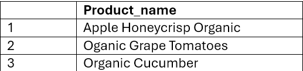
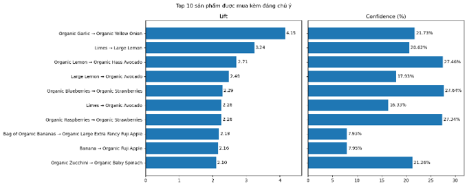
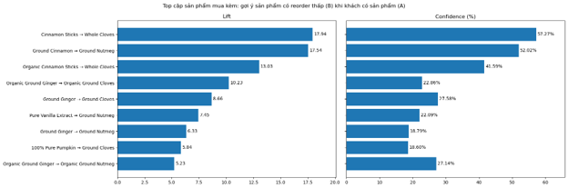
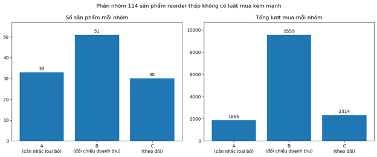
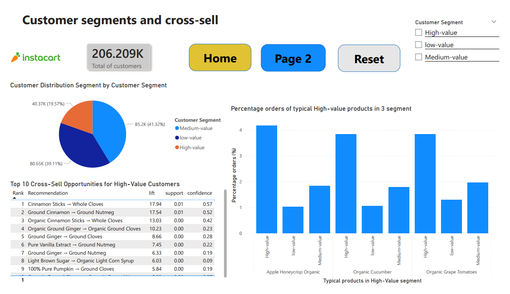
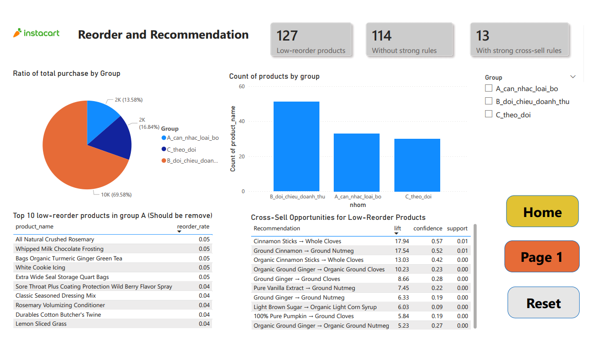

# Instacart Customer & Product Analytics

Phân khúc khách hàng bằng **RFM**, phân tích giỏ hàng bằng **Apriori** và đánh giá nhóm sản phẩm **mua lại thấp** trên dữ liệu Instacart (~3,4 triệu đơn hàng, 200K khách hàng, 49.688 sản phẩm).

**Công cụ:** SQL Server · Python (pandas, mlxtend) · Power BI

| | |
|---|---|
| 📄 Báo cáo đầy đủ | [Link PDF](report/) |

---

## 1. Business questions

Kết quả phục vụ **Chủ siêu thị / Store Manager** (quyết định chiến lược) và **Marketing Team** (quyết định chiến dịch).

1. **Phân khúc & cross-sell:** Mỗi phân khúc khách hàng (RFM) có hành vi mua theo sản phẩm nào, và nên đề xuất cross-sell gì để tăng tần suất mua và giá trị giỏ hàng?
2. **Sản phẩm mua lại thấp:** Sản phẩm nào có reorder rate thấp, và trong số đó, sản phẩm nào vẫn hay xuất hiện cùng sản phẩm bán chạy (sản phẩm mồi) để quyết định **giữ kèm bán chéo** hay **cân nhắc loại bỏ**?

## 2. Key findings

### Câu hỏi 1: Phân khúc khách hàng & cross-sell

- Khách hàng được chia thành 3 phân khúc **High / Medium / Low-value** bằng RFM (điểm tổng ≤ 4 / ≤ 6 / còn lại).
- **3 sản phẩm đặc trưng** của nhóm High-value (chỉ xuất hiện ở nhóm này trong top 20 bán chạy): *Apple Honeycrisp Organic, Organic Grape Tomatoes, Organic Cucumber*.



- **8/10 cặp** sản phẩm có lift cao nhất trong nhóm High-value đạt đồng thời **lift ≥ 2** và **confidence ≥ 15%** (ví dụ: Organic Garlic → Organic Yellow Onion, lift 4,15, confidence 21,73%) → ứng viên cho gợi ý mua kèm.



> **Quy ước chiều luật:** mỗi cặp giữ chiều có confidence cao hơn; nếu support của vế phải (B) > 0,15 thì đổi chiều, vì confidence cao lúc đó chủ yếu do B vốn phổ biến chứ không do A kéo theo.

### Câu hỏi 2: Sản phẩm mua lại thấp

- Phạm vi: **127 sản phẩm** có reorder rate < 5% và ≥ 50 lượt mua.
- **13 sản phẩm** có ít nhất một luật mua kèm mạnh (lift ≥ 2, confidence ≥ 15%) → **nên giữ lại để bán kèm**, ví dụ: Whole Cloves, Ground Nutmeg, Organic Ground Cloves, Ground Cloves, Organic Light Corn Syrup, Organic Ground Nutmeg.
- Các cặp mua kèm nổi bật chủ yếu là **gia vị nấu nướng** (ví dụ Cinnamon Sticks → Whole Cloves, lift 17,94), phản ánh nhu cầu mua cùng nhau để nấu nướng. Mua lại thấp có thể do tiêu hao chậm hoặc đóng gói định lượng lớn.



- **114 sản phẩm còn lại** không có luật mạnh (chiếm khoảng 0,04% tổng lượt mua), được chia theo phân vị lượt mua trong nhóm low-reorder (P25 = 67, median = 91):

| Nhóm | Điều kiện | Số SP | Hành động |
|---|---|---|---|
| A | Lượt mua < P25 | 33 | Cân nhắc loại bỏ |
| B | P25 ≤ lượt mua < median | 51 | Đối chiếu doanh thu |
| C | Lượt mua ≥ median | 30 | Theo dõi |



**Top 5 sản phẩm ưu tiên cân nhắc loại bỏ (nhóm A):**

| Sản phẩm | Lượt mua | Mua lại | Reorder rate |
|---|---:|---:|---:|
| All Natural Crushed Rosemary | 61 | 3 | 4,92% |
| Whipped Milk Chocolate Frosting | 61 | 3 | 4,92% |
| Bags Organic Turmeric Ginger Green Tea | 62 | 3 | 4,84% |
| White Cookie Icing | 62 | 3 | 4,84% |
| Extra Wide Seal Storage Quart Bags | 64 | 3 | 4,69% |

## 3. Dashboard

Dashboard Power BI gồm: phân bố phân khúc khách hàng, sản phẩm đặc trưng và cặp mua kèm theo phân khúc, nhóm sản phẩm mua lại thấp.

<!-- Thay bằng ảnh chụp dashboard -->



## 4. Approach

```
SQL Server  →  Python (Apriori)  →  Power BI
```

| Công cụ | Vai trò | Lý do chọn |
|---|---|---|
| **SQL Server** | Import dữ liệu, tính RFM (CTE, window function `NTILE`), trích giỏ hàng theo phân khúc | Xử lý tốt ~32 triệu dòng; logic phân khúc rõ ràng, tái lập được |
| **Python** (pandas, mlxtend) | Chạy Apriori, tính support / confidence / lift, lọc luật | Thư viện sẵn có cho association rules; linh hoạt khi lọc, chọn chiều luật |
| **Power BI** | Trực quan hóa và dashboard cho người ra quyết định | Tương tác, lọc theo phân khúc, phù hợp người dùng nghiệp vụ |

**RFM (dùng proxy vì không có dữ liệu giá):** Recency = `days_since_prior_order` của đơn gần nhất · Frequency = số đơn · Monetary = kích thước giỏ hàng trung bình. Mỗi chỉ số chia 3 mức bằng `NTILE(3)` (1 = tốt nhất).

## 5. Data & limitations

- **Nguồn:** [Instacart Market Basket Analysis (Kaggle)](https://www.kaggle.com/c/instacart-market-basket-analysis) — 3,4 triệu đơn, 32.434.489 dòng `prior`, 134 aisle, 21 department.
- **Không có giá/doanh thu:** Monetary dùng proxy là basket size; không thể làm ABC analysis theo giá trị tài chính. Kết luận loại bỏ sản phẩm dựa trên hành vi mua lại và mua kèm, mang tính **định hướng**, cần đối chiếu dữ liệu giá trước khi áp dụng.
- **Recency là proxy** từ `days_since_prior_order`, không phải ngày giao dịch thực.
- **Ngưỡng** (min_support, lift ≥ 2, confidence ≥ 15%, ≥ 50 lượt mua) là lựa chọn phân tích, kết quả thay đổi nếu đổi ngưỡng.
- Luật kết hợp thể hiện **tương quan**, không phải quan hệ nhân quả.

## 6. Repository structure

```
instacart-analytics/
├── README.md
├── report/        # Báo cáo PDF
├── notebooks/     # Apriori Q1, Q2
├── sql/           # Import, RFM, trích giỏ hàng
└── images/        # Ảnh dùng trong README
```

> Dữ liệu thô (CSV/pkl) không đưa lên repo (giới hạn 100MB của GitHub); tải từ Kaggle.

## 7. How to reproduce

1. Tải dữ liệu từ Kaggle và import vào SQL Server (database mới).
2. Chạy các file trong `sql/` theo thứ tự: import → RFM → xuất giỏ hàng (`high_value_products.csv`, `low_reordered_basket.csv`).
3. Cài thư viện: `pip install pandas mlxtend`.
4. Chạy `notebooks/` theo thứ tự: Q1 → Q2.
5. Mở dashboard Power BI và trỏ nguồn dữ liệu tới kết quả đã xuất.

## 8. Full report

📄 [Báo cáo đầy đủ (PDF)](report/Instacart Customer Segmentation.pdf)
